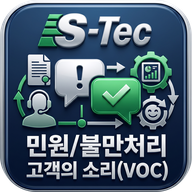

# S-Tec Complaint Response System



**에스텍 그룹 고객사 Complaint 대응 프로그램** · v1.5.0

고객사가 제기한 Complaint를 **① 발생 사업장 선정 → ② 대·중·소 분류 → ③ 내용 작성 → ④ 출력** 순서로 처리하면,
대응방안을 **Word(머리글·바닥글 서식) · PPT(16:9) · PDF(PPT와 같은 디자인)** 3종으로 바로 만들어 줍니다. 웹 버전과 안드로이드 앱(APK)으로 씁니다.

## 내려받기

| 구분 | 파일 | 주소 |
|---|---|---|
| 웹 버전 | [index.html](index.html) | https://sadness500-boop.github.io/S-Tec-Complaint-Response-System/ |
| 웹 버전 (버전별) | [releases/S-Tec-Complaint-Response-System_v1.5.0.html](releases/S-Tec-Complaint-Response-System_v1.5.0.html) | |
| 안드로이드 앱 (최신) | `stcr-latest.apk` | https://github.com/sadness500-boop/S-Tec-Complaint-Response-System/releases/download/app-latest/stcr-latest.apk |
| 안드로이드 앱 (버전별) | `releases/S-Tec-Complaint-Response-System_v1.5.0.apk` | 릴리스 `v1.5.0` |

- **APK는 GitHub Actions가 만듭니다.** `index.html` 또는 `version.json`을 올리면 Actions 탭의 "Android APK"가 실행되어 약 5분 뒤 `releases/` 폴더와 릴리스에 버전 이름이 붙은 APK가 올라갑니다. Actions 탭 › Android APK › Run workflow 로 직접 실행할 수도 있습니다.
- **안드로이드 설치:** APK 내려받기 → "출처를 알 수 없는 앱 설치 허용" → 설치. Play 프로텍트 경고가 뜨면 "무시하고 설치".
- 서명 키(`android-keystore/stcr-debug.keystore`)를 고정해 두었으므로 새 버전은 지우지 않고 덮어 설치하면 됩니다.
- **웹 버전 주소를 열려면** 저장소 Settings › Pages › Branch를 `main` / `/(root)` 로 한 번 켜야 합니다.
- 웹 버전은 인터넷 없이도 동작합니다(로그인·동기화만 인터넷 필요). 앱에서 출력한 파일은 「저장·보내기」 창으로 저장하거나 카카오톡 등으로 보냅니다.

## 주요 기능

1. **상단 기능 (근태관리 프로그램과 동일)** — Complaint 담당 지정(지정해야 프로그램 구동, 사진·직책·담당 지사), 다운로드 QR(웹·앱), 친구 추천, 내 계정(로그인·관리자 페이지), 주간·야간·시스템 화면.
2. **① 발생 사업장 선정** — 에스텍베스트 동부·서부·남부·중부 지사 **사업장 151곳**(사업장명·주소·계약일·유형·계약 업종·근무형태·계약 인원(남/여)·업종별 인원(보안/미화/기타)·현장 책임자·사업장 전화). 지사 버튼·검색으로 고르고, 목록에 없으면 직접 입력.
3. **② Complaint 대·중·소 분류** — 대분류 8 · 중분류 26 · 소분류 80, 소항목별 심각도(중대/주요/일반)·즉시 조치·단기 개선·재발방지·근무자 조치 기준. 내용 키워드로 항목 추천.
4. **③ 내용 작성** — 접수 정보·Complaint 내용·고객사 요구사항·사실관계, 고객사 제출용 / 내부 보고용 구분(제출용은 근무자 징계 내용 제외).
5. **⑤ 근무자 조치 문서 (내부·대외비)** — Complaint를 초래한 당사 근무자에 대한 근무자 조치 계획서를 고객사 대응자료와 별도로 Word·PPT·PDF 3종 출력: 대상·발생 개요, 위반 사실·근거(3대 중대위반 표시), 징계 양정(징계 없음 → 구두 주의 → 서면 경고 → 감급 → 정직 → 해고 검토, 항목 기준 + 위반 이력으로 자동 권고), 조치 결정(안)·결재란, 진행 절차(D+0~D+30)·법적 유의사항, 재발방지 교육, 붙임 경위서·확인서(재발방지 서약) 양식.
6. **출력 기록 관리** — 최근 출력 기록을 눌러 불러오기, 🗑 한 건 삭제 · 선택 삭제 · 전체 삭제(로그인 시 모든 기기에 함께 반영).
7. **④ 대응방안 출력** — 주요 보고내용, 접수 개요, **발생 사업장 정보**, 4M 원인분석, 대응 방안(D+0 / D+1~7 / 재발방지), 법적 검토(56개 조항), 실행 일정(D+0~D+30), 고객사 회신(안). 화면에서 고친 내용이 그대로 출력됩니다.

## 매뉴얼 (docs/)

| 문서 | Word | PPT |
|---|---|---|
| 사용자 매뉴얼 | [docx](docs/S-Tec-Complaint-Response-System_사용자매뉴얼_v1.3.0.docx) | [pptx](docs/S-Tec-Complaint-Response-System_사용자매뉴얼_v1.3.0.pptx) |
| 제작자 관리 사용매뉴얼 | [docx](docs/S-Tec-Complaint-Response-System_제작자관리매뉴얼_v1.3.0.docx) | [pptx](docs/S-Tec-Complaint-Response-System_제작자관리매뉴얼_v1.3.0.pptx) |

## 에스텍 통합 로그인 · 프로그램별 권한 (v1.2.0)

하나의 아이디로 6개 프로그램을 씁니다 — Attendance Management Software(근태관리)·**S-Tec Complaint Response System**·S-Tec short estimate·S-Tec-Business-Site-Overview·S-Tec-Quotation-System·Workload-Based Cost and Labor Estimation Method. 가입 승인·차단·계정 기한은 모든 프로그램에 함께 적용되고, **사용 권한·사용기한·관리 범위(담당 지사)는 프로그램마다 따로** 지정합니다(관리자 페이지 › 「🔐 프로그램별 권한」).

- **처음 한 번:** 근태관리 Supabase 프로젝트 → SQL Editor → [`server/supabase_app_access.sql`](server/supabase_app_access.sql) 전체 붙여넣기 → Run. 실행 전에는 승인된 사용자 모두가 각 프로그램을 그대로 사용합니다(제작자 화면에 안내 표시).
- 제작자·관리자는 모든 프로그램 사용. 일반 사용자는 프로그램별 「사용」이 지정되어야 열립니다. 근태관리는 자체 「관리 범위」를 그대로 씁니다.
- Complaint 프로그램에서는 관리 범위(담당 지사)에 따라 ① 사업장 목록이 그 지사 사업장만 보입니다.

## 제작자 관리 (로그인)

- [`auth-config.json`](auth-config.json)이 **Attendance Management Software와 같은 Supabase 서버**를 가리킵니다 → 하나의 아이디로 두 프로그램을 씁니다(통합 로그인). 관리자 페이지(내 계정 카드 › 관리자 페이지)에서 가입 승인·차단·사용기한·임시 비밀번호·강제 로그아웃·접속기록·기기 관리·앱 전체 잠금.
- **따로 쓰려면:** 새 Supabase 프로젝트 → SQL Editor에서 [`server/supabase_setup.sql`](server/supabase_setup.sql) 실행(제작자 이메일 한 곳 수정) → `auth-config.json` 두 값 교체.
- **끄는 법:** `auth-config.json` 의 `"enabled": false`.
- 로그인하면 **Complaint 담당·화면 설정·출력 기록**이 계정에 저장되어 여러 기기에서 똑같이 보입니다.
- publishable(anon) 키는 공개돼도 되는 키입니다. **secret / service_role 키는 절대 저장소·앱에 넣지 마세요.**

## 개인정보

- 공개 저장소이므로 사업장 현장 책임자 **휴대폰 번호 뒷자리는 `????`로 가렸습니다**(사업장 지도 프로그램과 같은 기준).
- ※ 법령 요약은 실무 참고용입니다. 적용 전 국가법령정보센터(law.go.kr) 원문 및 노무 자문으로 확인하십시오.

## 파일 구성

```
index.html                     프로그램 전체 (한 파일, 라이브러리 내장)
releases/                      버전별 HTML · APK
source/                        index.html 을 만드는 원본(app.js · ui.js · kb.js(분류·법령) · sites.js(사업장) · build.py)
auth-config.json               로그인 서버 연결 설정
server/supabase_setup.sql      로그인 서버(Supabase) 설정 SQL (별도 서버를 쓸 때)
server/supabase_app_access.sql 프로그램별 사용 권한 SQL (통합 로그인 서버에 한 번 실행)
icons/ · manifest.webmanifest · sw.js   앱 아이콘 · 홈 화면 설치(PWA)
package.json · capacitor.config.json · android-keystore/   안드로이드 앱 포장
.github/workflows/android-apk.yml       안드로이드 앱 자동 빌드
```

## 변경 이력

- **v1.5.0** (2026-11-15) — ③에 「공문·메일·카톡으로 받은 Complaint 불러오기」: PDF(스캔본 포함)·Word·한글 HWPX·메일 .eml·카톡 대화 .txt·사진/캡처(한국어 글자 인식) 파일을 올리거나 Ctrl+V로 붙여넣으면 사업장·장소·접수 경로·일시·제기자·근무자·내용·요구사항을 자동 입력하고 Complaint 항목 추천, 원문은 Word·PPT 「붙임」으로 첨부. 모든 처리는 기기 안에서만(lib/ocr: tesseract.js, lib/pdf: pdf.js)
- **v1.4.1** (2026-11-15) — PPT가 PowerPoint에서 「복구」 오류로 열리지 않던 문제 수정(영상 슬라이드 도형 ID 중복 제거·영상 재생 정보 추가·파일 내 폴더 항목 제거, Word도 동일 정리), ② Complaint 분류를 첫 화면에 배치(카카오맵은 분류 아래로), 고객사·근무자 PPT·PDF 표지 로고를 앱 아이콘(VOC)으로 교체
- **v1.4.0** (2026-11-15) — 메인 화면 ④ 영역에 고객 불만 유발 사례 영상 4편(미화 물품 부주의·방문객 고압 응대·상황실 졸음·유튜브 시청) 자동 연속 재생, 영상 전환 시 모자이크 효과, 「이 사례로 작성」으로 해당 Complaint 항목 자동 선택 (media/main)
- **v1.3.0** (2026-11-14) — PC 설치 앱 아이콘 갱신(manifest id·아이콘 캐시 갱신), ① 사업장 목록 아래 카카오맵 위치(지사별 색 점·선택·길찾기), 고객사·근무자 PPT에 현장 피규어 사진·근무 영상(PPT 재생) 반영, Supabase 프로그램별 권한 SQL 적용, 사용자·제작자 매뉴얼(Word·PPT)
- **v1.2.0** (2026-11-14) — 새 앱 아이콘(민원/불만처리 · 고객의 소리 VOC), ⑤ 근무자 조치 문서(Word·PPT·PDF) 별도 출력, 고객사 대응 PPT·PDF 디자인 개선(밝은 바탕·포인트 컬러), 출력 기록 삭제 관리(한 건·선택·전체), 통합 로그인 프로그램별 권한(🔐 탭, server/supabase_app_access.sql)
- **v1.1.0** (2026-11-14) — 상단 기능(Complaint 담당·다운로드 QR·친구 추천·로그인·주간/야간/시스템) 반영, 에스텍베스트 사업장 151곳 목록 반영(① 사업장 선정 → ② 분류 → ③ 작성 → ④ 출력), Word·PPT·PDF에 발생 사업장 정보(사업장 현황 슬라이드) 기재, 안드로이드 앱(APK) 자동 빌드
- **v1.0.0** (2026-11-14) — 최초 버전: Complaint 대·중·소 분류, 대응방안 Word·PPT·PDF 3종 출력

---
Designed & Developed by **Rat Rae Choi**
